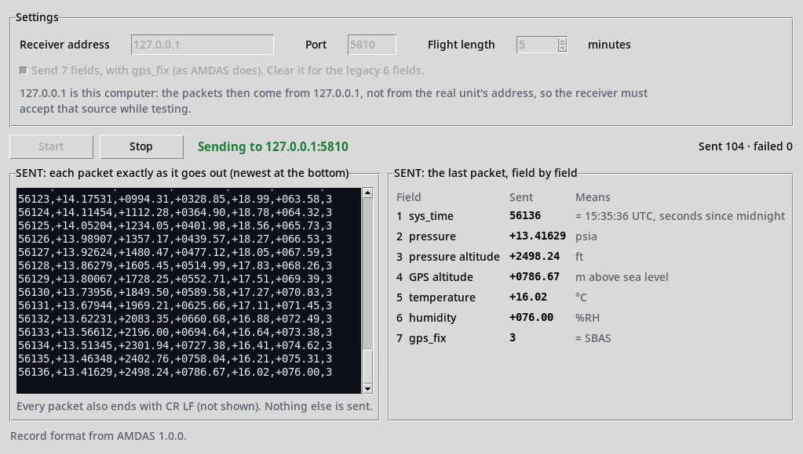

# AMDAS UDP test sender

A small Windows program that sends the **AMDAS** UDP transmission once a second, exactly as the real unit
sends it, from a simulated flight. Use it to develop and test a receiver without the aircraft equipment.

AMDAS (Airborne Meteorological Data Acquisition System) reads a Digiquartz pressure sensor, a Rotronic
temperature/humidity probe and a Certus GPS/INS, and sends one line per second over a radio link. The record
is built by AMDAS's own formatting code (copied unchanged into `amdas/`), so the bytes are identical.

## Getting it

1. Open the **[Releases](../../releases)** page and download `AMDAS-UDP-Sender.exe`. Nothing to install.
2. Double-click it. The first time, Windows may say **"Windows protected your PC"** because the program is
   not signed: click **More info**, then **Run anyway**.

## Using it



1. **Receiver address** and **Port**: where to send. The defaults, `127.0.0.1` port `5810`, send to a
   receiver on the same computer.
2. **Flight length**: one simulated flight, 5 to 600 minutes (default 20). It then starts again.
3. **Send 7 fields**: ticked sends what AMDAS sends today. Clear it to get the older 6-field record.
4. **Start**. The first record goes out at the next whole second. **Stop** ends it; settings can be changed
   while stopped.

What the window shows:

- **SENT, left:** every packet exactly as it goes out, newest at the bottom. Each also ends with CR LF.
  Nothing else is sent.
- **SENT, right:** the last packet taken apart field by field, with what each field means (sys_time as a
  UTC clock time, gps_fix as a fix name).

### Receiver on the same computer (127.0.0.1)

- The receiver listens on UDP port 5810, bound to `127.0.0.1` or to all addresses (`0.0.0.0`).
- The packets arrive **from 127.0.0.1**, not from the real unit's address. A receiver that only accepts the
  unit's address must accept 127.0.0.1 while testing.
- Traffic to 127.0.0.1 never reaches a network card. A receiver that captures packets from a network adapter
  (pcap/Npcap) instead of opening a socket will not see it, unless it captures on the Npcap loopback adapter.

### Receiver on another computer

Enter that computer's IP address. To test the receiver with no changes at all, give the sending computer the
real unit's IP address on that network: then the packets look exactly like the unit's.

### Quick check without a receiver

This prints what arrives on port 5810 (Python 3, any computer that receives the packets):

```python
import socket
s = socket.socket(socket.AF_INET, socket.SOCK_DGRAM)
s.bind(("0.0.0.0", 5810))
while True:
    data, source = s.recvfrom(1024)
    print(source[0], data)
```

## The record

One UDP datagram per second, ASCII, the record followed by CR LF (`\r\n`). Fields are separated by commas,
have a fixed width and always carry a sign; a field is never empty and never contains a space.

```
51893,+14.70098,-0009.48,+0000.00,+21.01,+054.73,0
SSSSS,±PP.PPPPP,±AAAA.AA,±GGGG.GG,±TT.TT,±HHH.HH,F
```

| # | Field | Width | Unit | Notes |
|---|---|---|---|---|
| 1 | sys_time | 5 digits | s | seconds since midnight UTC, `00000`–`86399` |
| 2 | pressure | ±2.5 | psia | Digiquartz absolute pressure |
| 3 | pressure altitude | ±4.2 | ft | from pressure, standard atmosphere (1013.25 hPa) |
| 4 | GPS altitude | ±4.2 | m | above mean sea level |
| 5 | temperature | ±2.2 | °C | |
| 6 | humidity | ±3.2 | %RH | 3 digits so 100 % fits: `+100.00` |
| 7 | gps_fix | 1 digit | | `0` none, `1` 2D, `2` 3D, `3` SBAS, `4` differential, `5` PPP, `6` RTK float, `7` RTK fixed. Not in the 6-field record |

- 7 fields: 50 characters, 52 bytes with CR LF. 6 fields: 48 characters, 50 bytes.
- A sensor that goes silent is sent as its all-zero placeholder at the same width (`+00.00000`,
  `+0000.00`, `+00.00`, `+000.00`); gps_fix is `0` with no GPS data.
- A value too big for its field is held at the largest that fits (`+9999.99`).

## The simulated flight

Each flight starts like the unit being switched on: on the ground at an airfield 20 m above sea level, with
no GPS fix for 40 s (GPS altitude `+0000.00`, gps_fix `0`), then a 3D fix, then SBAS. It climbs to about
3,000 ft above the field, cruises with small ups and downs, passes through a cloud (humidity reaches
`+100.00`, temperature drops a little), descends and lands. Pressure follows a standard atmosphere with a
slowly drifting sea-level pressure, so the pressure altitude is a little below zero on the ground.

sys_time comes from this computer's clock (the real unit uses GPS time), so keep the clock set right.

## Running from source

Python 3.8 or newer with Tkinter (the python.org installer includes it):

```
python amdas_udp_sender.py
python -m unittest discover -s tests
```

`python amdas_udp_sender.py --self-test` sends a few records to itself and opens the window briefly: exit code
0 means all is well. GitHub builds the .exe on Windows on every push (Actions tab); a tag such as `v1.0.0`
publishes it on the Releases page.
